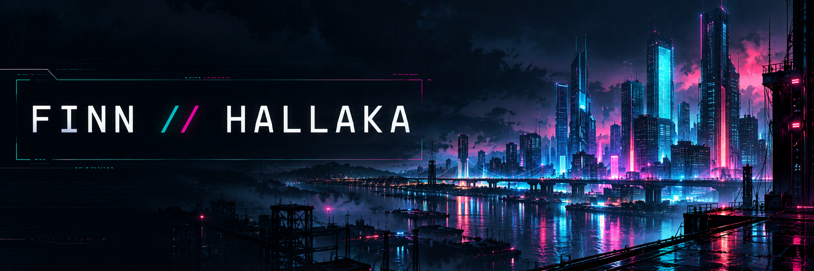
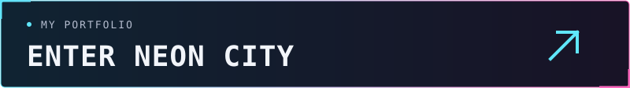

<a href="https://hallaka01.github.io/#work">Selected work ↗</a> &nbsp; / &nbsp; <a href="https://hallaka01.github.io/#about">About me ↗</a>

<code>Mobile apps / Personal projects / Always exploring</code>

I'm Finn, a Media Informatics student at HSMW. I work with Flutter and build native iOS apps around ideas from my own life.

## 01 // Selected work

**[YGO Scanner ↗](https://hallaka01.github.io/#ygo-scanner)** 
A native iOS app for scanning cards, organizing physical copies, and planning decks around a real collection.
[Screenshots & code examples](https://github.com/Hallaka01/ygo-scanner-showcase)

**[HSMWmobil ↗](https://hallaka01.github.io/#hsmwmobil)** 
I contribute to the frontend of a Flutter app built by students for students and university staff.
[Team on GitHub](https://github.com/HSMWmobil)

## 02 // Toolbox

`Flutter` · `Dart` · `SwiftUI` · `SwiftData`

Currently exploring APIs and app integrations.
